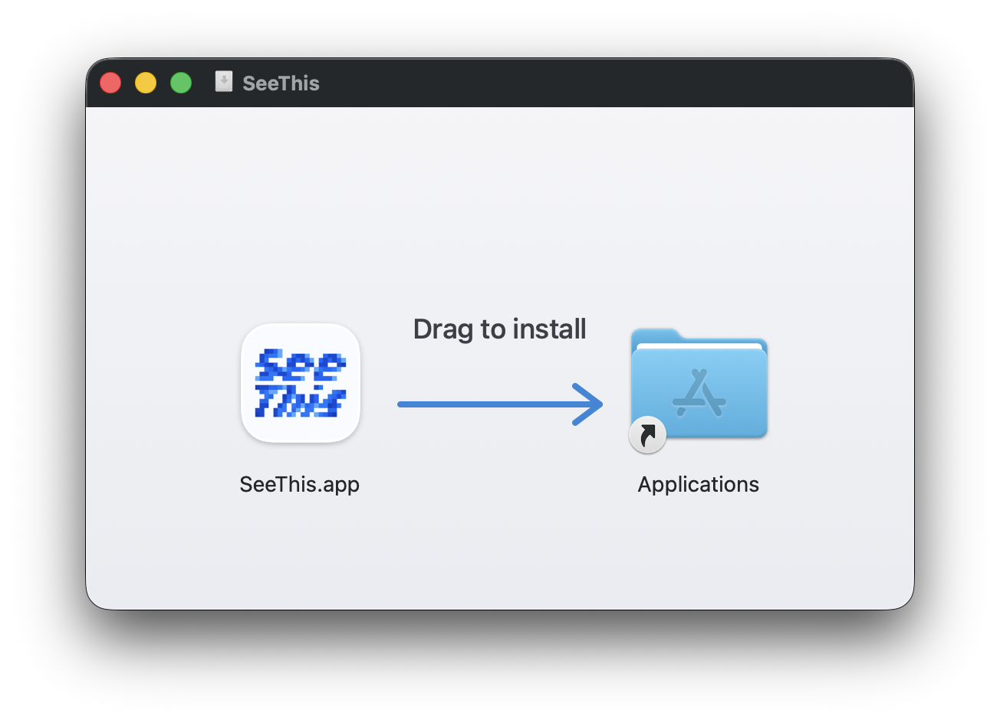
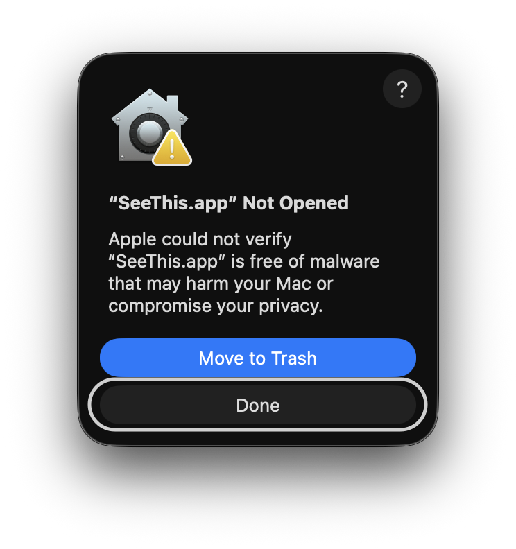
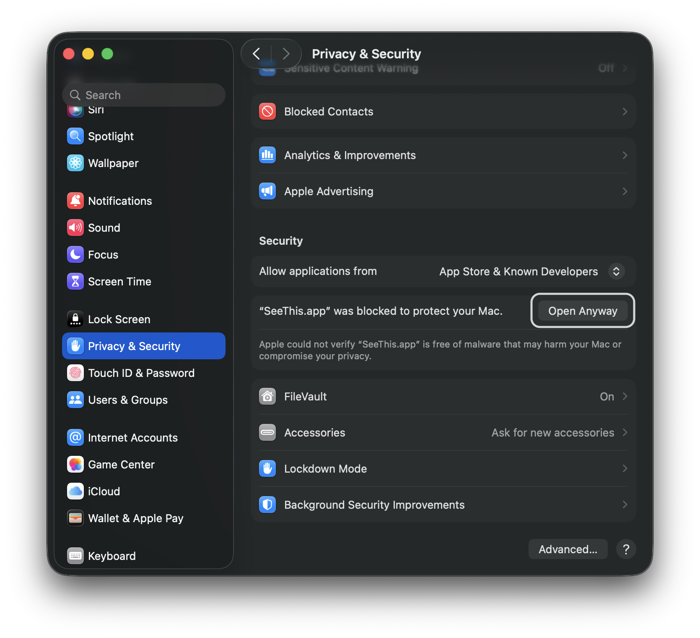
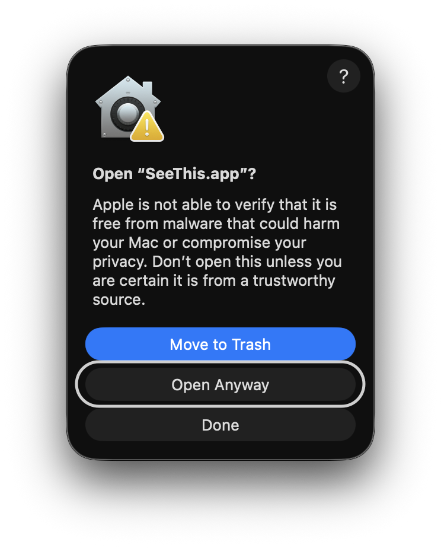

# Install SeeThis

SeeThis is an unsigned preview for macOS 15 or later. Local explanations require [Ollama](https://ollama.com/download) and at least one chat model.

## Install

1. Download and open the latest SeeThis DMG.
2. Drag `SeeThis.app` onto `Applications`.

   <div align="left">
     
   </div>

3. Open SeeThis from the Applications folder.
4. Eject the `SeeThis` installer volume.

## First launch

If macOS blocks SeeThis on first launch, complete these steps:

1. Click **Done** in the warning.

   <div align="left">
     
   </div>

2. Open **System Settings → Privacy & Security**, scroll down, and click **Open Anyway** next to SeeThis.

   <div align="left">
     
   </div>

3. Authenticate with Touch ID or your Mac login password when prompted.
4. When macOS asks for confirmation, click **Open Anyway** again.

   <div align="left">
     
   </div>

Only approve a copy downloaded from the SeeThis GitHub release.

## Accessibility

1. If SeeThis is not already enabled, click **Open Accessibility Settings…** in Getting Started.
2. Turn on SeeThis in **Privacy & Security → Accessibility** if it is off.
3. Return to SeeThis.

## Ollama

1. If Ollama is not installed, open Terminal and install it:

   ```sh
   curl -fsSL https://ollama.com/install.sh | sh
   ```

2. If you do not already have a local chat model, choose and install one from the [official Ollama model library](https://ollama.com/search).
3. Start Ollama if it is not already running, and keep it running while using local explanations.

## Update

1. Quit SeeThis and open the new DMG.
2. Drag `SeeThis.app` onto `Applications` and choose **Replace**.
3. If selection capture stops working, remove SeeThis from **Privacy & Security → Accessibility**, add it again, and turn it on.
