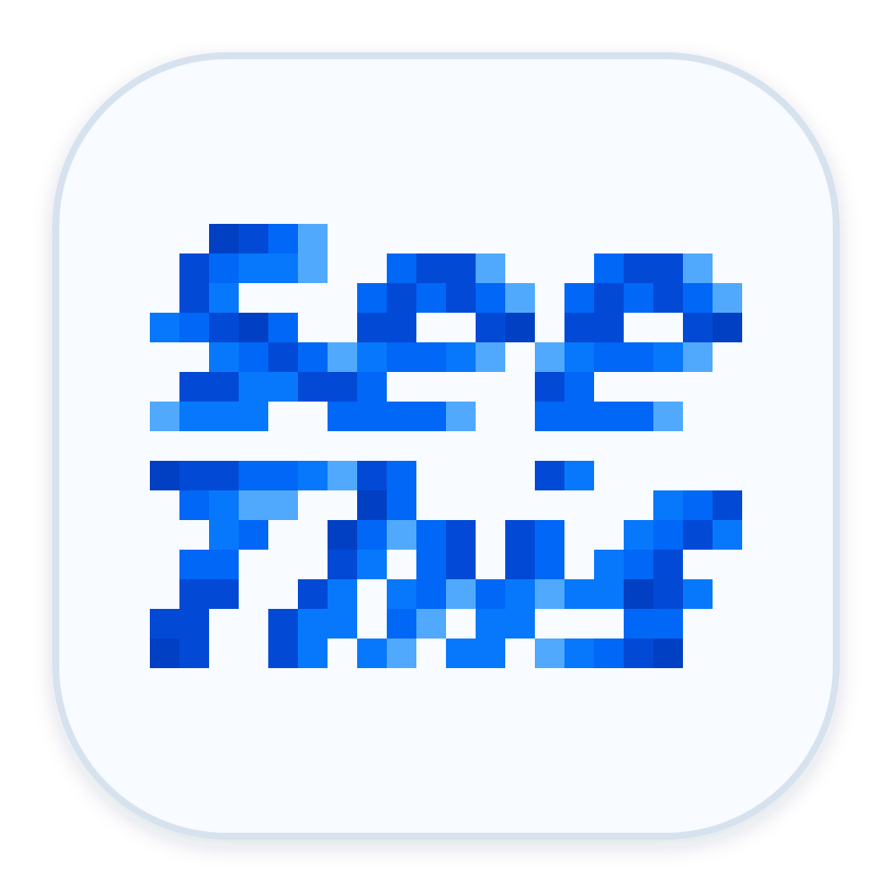
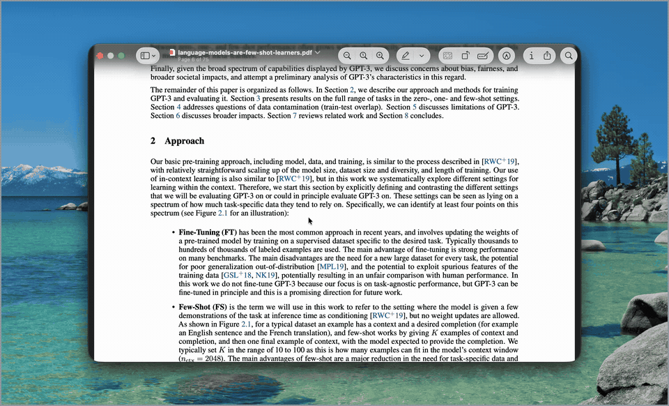

<h3 align="center">
  <br>
  SeeThis<br>
  <sub>Select it. Ask AI. Keep reading.</sub>
</h3>

<p align="center">
  <a href="https://github.com/hoodies-gent/see-this-macos/releases"></a>
  <a href="LICENSE"></a>
  
  <a href="https://github.com/hoodies-gent/see-this-macos/actions/workflows/ci.yml"></a><br>
  A macOS menu bar app that explains, translates, or answers questions about selected text.<br>
  Answers appear in a small overlay, from a local Ollama model by default.
</p>

<p align="center">
  
</p>

## Download

Get the unsigned preview DMG from the [latest release](https://github.com/hoodies-gent/see-this-macos/releases/latest).

> [!IMPORTANT]
> This preview is unsigned, so macOS may block it the first time you open it. Follow the [installation guide](INSTALL.md) to approve it and finish setup.

Requirements:

- macOS 15 or later (Intel Macs are untested)
- [Ollama](https://ollama.com/download) with at least one chat model

Prefer to build it yourself? See [Run from source](#run-from-source).

## Features

- **Quick answers.** Explain or translate selected text in a compact overlay, so you can keep reading.
- **Free-form questions.** Type your own question about the selection, then ask a follow-up if you need to.
- **Your own Lenses.** Save prompts you ask often as Lenses, so each is one click away.
- **Context files.** Drop a PDF, TXT, or Markdown file onto the overlay for more context ([example](Artwork/Demo/seethis-context-file.gif)).
- **Optional cloud translation.** Add your own DeepL API key to translate with DeepL.

## Use

1. Select text in any app.
2. Press <kbd>Command</kbd> + <kbd>D</kbd>, then choose a Lens or type your own question.
3. Read the response in the overlay, then press <kbd>Esc</kbd> to continue.

The default shortcut is <kbd>Command</kbd> + <kbd>D</kbd>. If another app already uses it, change it in Settings → General → Trigger Shortcut.

**Two ways to ask:**

- **Pick a Lens.** A Lens is a saved prompt that gives you an answer with one click. Explain and Translate are built in, and you can add your own in Settings → Lenses.
- **Type a question.** Use the field under the Lenses, for example "Why does this matter?". You can ask one follow-up.

## Privacy

SeeThis reads selected text through macOS Accessibility or a temporary Copy fallback that restores the previous pasteboard. It **does not** capture the screen, use OCR, or persist selections, attached file text, questions, or answers.

Explanations go to your Ollama model, which runs locally unless you use one of Ollama's cloud models. In that case Ollama sends your text to its servers, and SeeThis cannot tell. Installing a model from the Models page makes Ollama download it from the Ollama library. DeepL is optional (a DeepL API Free key), stores its key in Keychain, and sends text **only after** separate configuration and authorization.

## Run from source

Requirements:

- macOS 15 or later (tested on macOS 26)
- Xcode 26 or later
- [Ollama](https://ollama.com/download) with at least one chat model

Debug builds use ad hoc signing by default, so macOS may ask you to grant Accessibility access again after a rebuild. To keep the permission stable, create your own Code Signing certificate named `SeeThis Local Development` and copy `Config/Local.xcconfig.example` to `Config/Local.xcconfig`.

Then:

1. Open `SeeThis.xcodeproj` in Xcode.
2. Build and run the `SeeThis` scheme.
3. Complete Getting Started to grant Accessibility access, connect Ollama, and try the interaction.

## Current scope

SeeThis is an early, text-only proof of concept. It tries to read your selection through Accessibility and falls back to Copy, so it can work wherever you can select text, but results vary by app and document. Its complete reading flow is currently validated with academic PDFs that contain selectable text in Zotero desktop. The current Accessibility architecture is not packaged for Mac App Store distribution.

## Development

Run the unit tests with:

```bash
xcodebuild test -quiet \
  -project SeeThis.xcodeproj \
  -scheme SeeThis \
  -destination 'platform=macOS' \
  -only-testing:SeeThisTests
```
